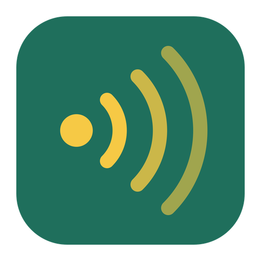

# cooee


[](LICENSE)

Google Meet in its own window, plus an always-on-top window of the **other people's faces** that
you can snap to where you look: under the webcam while you talk, out of the way in a corner while
you work. Meet's own pop-out has to be big to show anyone, because it also shows your own screen
share and gives everyone with their camera off a full-size tile. cooee's faces window shows only
the people on camera; everyone else is a name chip along the bottom edge.

## Install

```bash
curl -fsSL https://raw.githubusercontent.com/lockyc/cooee/main/install.sh | bash
```

This clones cooee to `~/.cooee`, builds it from source, installs it to `/Applications` and seeds
`~/.config/cooee/config.toml`. It needs Rust and the Xcode Command Line Tools; the installer adds
the Tauri CLI if it's missing, which takes several minutes the first time.

## First run

Open cooee from its menu-bar icon and sign in to Google in the Meet window. macOS asks for the
camera and microphone the first time Meet uses them. Each profile (below) signs in separately.

## Features

- **Menu-bar app**, with a Dock icon only while the Meet window is open. The menu has **Join Meet
  Link from Clipboard**, one **Open Meet** item per profile, and Diagnostics.
- **The faces window** opens when you join a call and closes when you leave. It shows the other
  participants with their cameras on, re-flowed to fit the window, and the rest as name chips.
  Before anyone else arrives it says **Waiting for others**, and it pulses when someone joins.
- **The controls window** is open for the whole call: your own camera, mirrored, beside **Mute**,
  **Camera** and **Leave**. A button turns red while that device is off. It reopens where you
  last left it.
- **The share window** opens when someone else presents and closes when they stop, showing their
  screen whole. Your own share never opens it. It reopens at the size and place you last gave it.
- **Presenting.** Meet's Share button asks whether to share a window (darkfield's canvas, say) or
  your entire screen, then opens the macOS picker for that choice.
- Closing any of these windows mid-call hides it; the menu's **Windows** submenu (or the faces
  and controls hotkeys) brings it back.
- **Spots.** **Talk** is centred under the top edge of your main display (the one with the menu bar), where a top-mounted
  webcam sits. **Aside** is that screen's bottom-right corner. Dragging or resizing the window
  never changes a spot; **Save Talk** / **Save Aside** does.
- **Profiles.** Each profile is its own Google sign-in. A Meet link carrying `authuser=<email>`
  opens in the profile with that account; otherwise cooee asks which profile to use.
- **One call at a time.** A join that arrives during a call asks before leaving it.
- **Open Meet links from other apps** — `cooee://join?profile=<name>&url=<percent-encoded Meet
  link>` opens a link in a profile, and
  `~/Library/Application Support/au.lsjc.cooee/profiles.json` lists the profiles, for a link
  router such as [Manicule](https://github.com/lockyc/manicule) to offer them.

| Default hotkey | Action | `[hotkeys]` key |
|---|---|---|
| ⌃⌥⌘T | Snap the faces window to Talk | `talk` |
| ⌃⌥⌘A | Snap to Aside | `aside` |
| ⌃⌥⌘S | Cycle size (keeps the top-centre fixed) | `cycle_size` |
| ⌃⌥⌘F | Show or hide the faces window | `toggle_faces` |
| ⌃⌥⌘C | Show or hide the controls window | `toggle_controls` |
| ⌃⌥⌘M | Show or hide the Meet window | `toggle_meet` |
| ⌃⌥⌘⇧T | Save the current position as Talk | `save_talk` |
| ⌃⌥⌘⇧A | Save the current position as Aside | `save_aside` |

## Configuration

`~/.config/cooee/config.toml` (or `$COOEE_CONFIG`), read at launch. A missing file means all
defaults; an unknown key is an error.

```toml
[[profile]]
name = "work"
account = "me@example.com"

[[size]]
width = 560
height = 350

[hotkeys]
talk = "Ctrl+Alt+Cmd+T"
```

**`[[profile]]`** (repeatable; none declared means one profile named `default`)

| Key | Default | What it does |
|---|---|---|
| `name` | required | The profile's name, unique. It keys the sign-in, so renaming a profile signs it out. |
| `account` | none | The Google account email matched against a Meet link's `authuser`. |

**`[[size]]`** (repeatable; the steps **Cycle size** moves through, in points)

| Key | Default | What it does |
|---|---|---|
| `width`, `height` | 360×225, 560×350, 800×500 | One faces-window size. Talk's default uses the middle one, Aside's the smallest. |

**`[hotkeys]`** — each key in the hotkey table above, as an accelerator like `Ctrl+Alt+Cmd+T`
(`Cmd`, `Ctrl`, `Alt`, `Shift`).

## Limits

cooee reads the call from Meet's page, so a change to Meet's layout can break its windows.
When it can't find the video tiles it says so; in a call, **Diagnostics → Save Meet Layout
Snapshot** writes the tiles' structure (no video, no chat) to `adapter-dump.json` and reveals it,
which is what a fix is made from. Faces show no cue for who is speaking.

## Status

Early and not yet released; in use in live calls. What's next: [docs/FOLLOWUPS.md](docs/FOLLOWUPS.md).

## Development

```bash
git clone https://github.com/lockyc/cooee && cd cooee
just run      # build a debug .app and run it against examples/config.toml
just gate     # format check, clippy, tests
```

Architecture, conventions and the release process: [CLAUDE.md](CLAUDE.md).

## License

MIT — see [LICENSE](LICENSE).
